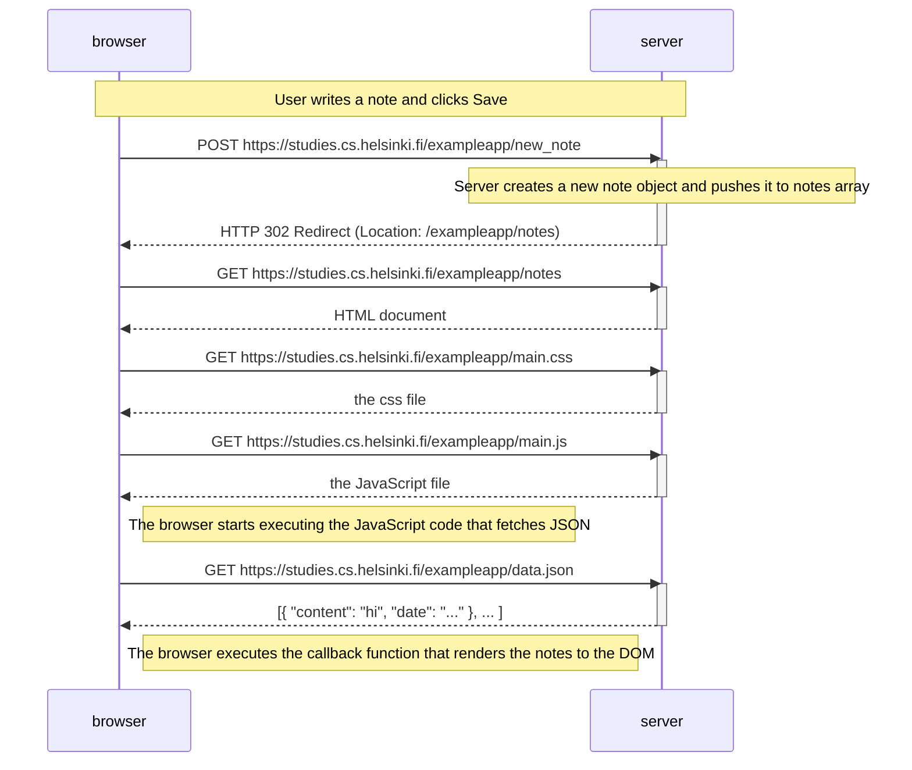
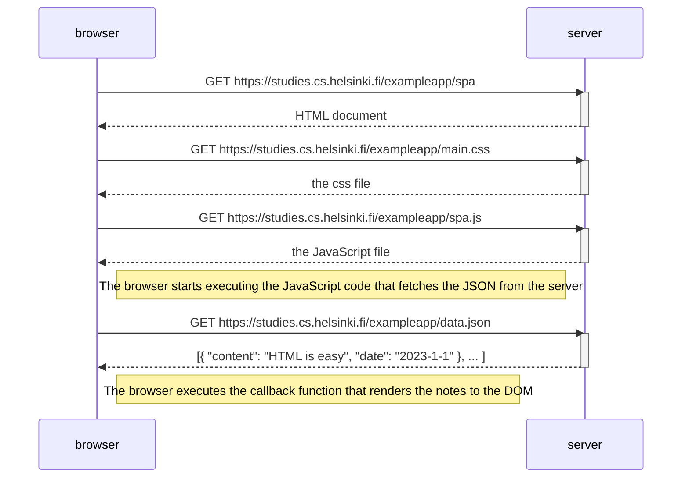

# Part 0 Exercises

## Exercise 0.4: New note diagram



## Exercise 0.5: Single page app diagram


## Exercise 0.6: New note in Single page app diagram

```mermaid
sequenceDiagram
    participant browser
    participant server

    Note over browser,server: User writes a note and clicks Save
    Note right of browser: Browser runs event handler, prevents default submit, adds note to list, and redraws DOM locally
    
    browser->>server: POST [https://studies.cs.helsinki.fi/exampleapp/new_note_spa](https://studies.cs.helsinki.fi/exampleapp/new_note_spa) (Content-Type: application/json)
    activate server
    Note over server: Server creates note object and pushes to notes array
    server-->>browser: HTTP 201 Created
    deactivate server

    Note right of browser: The browser stays on the same page and no full reload happens
